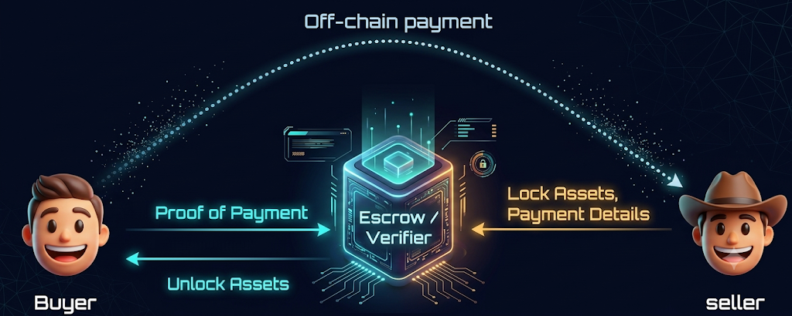
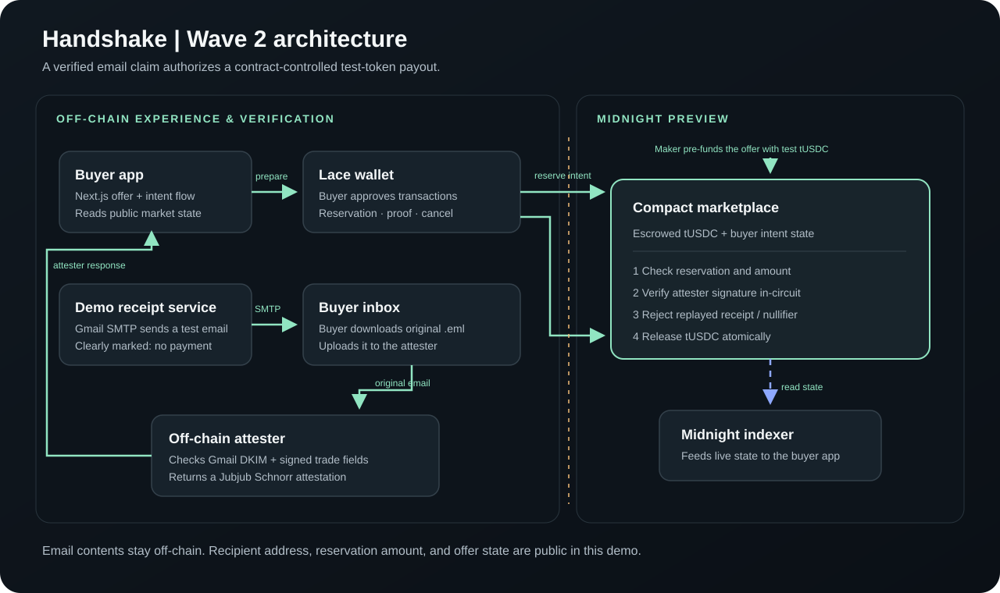
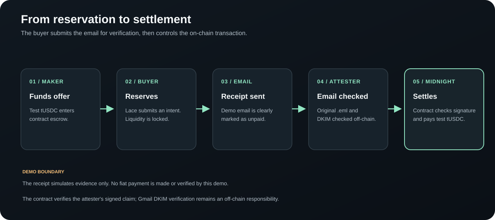

# Handshake 🤝

<p align="center">
  <strong>Payment evidence in. Escrowed tokens out.</strong>
</p>

<p align="center">
  A privacy-preserving peer-to-peer settlement prototype on the <a href="https://midnight.network">Midnight Network</a>.<br />
  Verifies real-world off-chain payment receipts and releases on-chain escrow without exposing private receipt data on a public ledger.
</p>

<p align="center">
  <a href="https://midnight.network"></a>
  <a href="https://docs.midnight.network"></a>
  <a href="https://nextjs.org"></a>
  <a href="https://www.typescriptlang.org"></a>
  <a href="https://lace.io"></a>
  
</p>

<p align="center">
  <a href="pitch/Handshake-Wave-2-Pitch.pptx">📊 <b>Wave 2 Pitch Deck</b></a> •
  <a href="midnight-contract/contracts/handshake-market.compact">📜 <b>Marketplace Contract</b></a> •
  <a href="midnight-contract/ATTESTOR_DEPLOYMENT.md">⚙️ <b>Attester Deployment</b></a> •
  <a href="src/app/guide/page.tsx">📖 <b>Interactive Guide</b></a> •
  <a href="https://github.com/bytes1/handshake">🐙 <b>GitHub Repository</b></a>
</p>

<p align="center">
  
</p>

---

> [!IMPORTANT]
> **Wave 2 Demonstration Boundary & Disclaimer**
> - **Testnet only:** Handshake runs live against **Midnight Preview**.
> - **Synthetic / Test receipts:** The receipt is generated for demonstration and verification testing; it does not represent an actual fiat charge or bank transfer.
> - **Handshake tUSDC:** Custom capped test token deployed on Midnight with 6 decimal places. It is **not** Circle USDC and carries zero monetary redemption value.
> - **No on-chain refund rail:** The Compact contract escrows and releases tokens; it cannot reverse or refund off-chain fiat rails.

---

## 📑 Table of Contents

- [The Core Challenge](#the-core-challenge)
- [Why Handshake](#why-handshake)
- [System Architecture](#system-architecture)
  - [High-Level Topology](#high-level-topology)
  - [Settlement Lifecycle](#settlement-lifecycle)
- [Privacy & Trust Model](#privacy--trust-model)
- [What the Compact Contract Does](#what-the-compact-contract-does)
- [Wave 2 Progress](#wave-2-progress)
- [Deployed Preview Contracts](#deployed-preview-contracts)
- [Quick Start Guide](#quick-start-guide)
  - [Prerequisites](#prerequisites)
  - [1. Clone & Install](#1-clone--install)
  - [2. Run the Frontend](#2-run-the-frontend)
  - [3. Compile and Deploy Contracts](#3-compile-and-deploy-contracts)
  - [4. Run the Attester](#4-run-the-attester)
  - [5. Run Contract Tests](#5-run-contract-tests)
- [Step-by-Step Buyer Walkthrough](#step-by-step-buyer-walkthrough)
- [Build & Quality Checks](#build--quality-checks)
- [Product Direction & Wave 3 Roadmap](#product-direction--wave-3-roadmap)
- [Buildathon Submission Notes](#buildathon-submission-notes)

---

## The Core Challenge

In peer-to-peer marketplaces and tokenized asset exchanges, off-chain payment networks (fiat rails, banking portals, emails, payment apps) and on-chain assets operate in disconnected silos.

```
┌─────────────────────────────────┐                 ┌─────────────────────────────────┐
│     Off-Chain Payment Rail      │                 │       On-Chain Asset Ledger     │
│   (Banks, PayPal, Email Receipts)│                 │   (Midnight Tokenized Escrow)   │
└────────────────┬────────────────┘                 └────────────────▲────────────────┘
                 │                                                   │
                 └─────────────── Coordination Gap ──────────────────┘
                     How do you coordinate settlement without exposing
                     private receipt data & PII on a public blockchain?
```

This presents a critical trade-off:
1. **Public ledger exposure:** Publishing receipts or proof of payment on-chain exposes buyer personal identifiable information (PII), emails, invoice numbers, and financial details.
2. **Centralized escrow risk:** Relying on centralized marketplace custodians re-introduces counterparty risk, single points of failure, and regulatory hurdles.

---

## Why Handshake

Handshake resolves this dilemma by bridging cryptographically verified payment evidence with zero-knowledge smart contract settlement on Midnight:

- 🛡️ **Zero-Knowledge & Off-Chain Verification:** The original `.eml` payment receipt and its cryptographic DKIM signatures are parsed and validated strictly off-chain. The email body and personal details **never touch the blockchain**.
- ✍️ **Jubjub Schnorr Attestations:** The off-chain attester validates the DKIM signature against DNS keys and issues a contract-bound Schnorr signature containing only the essential trade commitments.
- 🔒 **Trust-Minimized Escrow:** The Compact smart contract holds seller-funded test tokens in escrow, reserves inventory for buyer intents, validates the attester's signature in-circuit, and transfers tokens directly to the buyer's wallet.
- 🔁 **Double Replay Protection:** The contract consumes both a receipt commitment and a buyer nullifier in the settlement transaction, ensuring that a receipt can never be submitted twice.

---

## System Architecture

### High-Level Topology

The diagram below illustrates the boundary between the off-chain user experience, the receipt verifier, and the Midnight Preview network:



### Settlement Lifecycle

A seamless 5-stage coordination process connects the buyer reservation to final escrow release:



| Step | Actor | Action | Privacy & Security Scope |
| :--- | :--- | :--- | :--- |
| **01** | **Maker** | Funds Offer | Deposits test tUSDC into the Compact contract escrow. |
| **02** | **Buyer** | Reserves Offer | Locks inventory via Lace transaction; creates on-chain intent commitment. |
| **03** | **Service** | Dispatches Receipt | Sends demo receipt email via Gmail SMTP containing matching trade details. |
| **04** | **Attester** | Verifies Evidence | Validates DKIM & trade fields off-chain; signs contract-bound Jubjub claim. |
| **05** | **Midnight** | Settles Trade | Compact contract verifies attestation in-circuit and releases reserved tUSDC. |

---

## Privacy & Trust Model

Handshake enforces strict separation between private evidence verification and public state verification:

```
┌────────────────────────────────────────────────────────┐
│                      OFF-CHAIN                         │
│  • Full raw .eml RFC-822 message                       │
│  • Gmail DKIM signature validation (RSA-SHA256)         │
│  • Sender, receiver, subject, and transaction headers  │
│  • Sensitive personal information (PII)                │
└──────────────────────────┬─────────────────────────────┘
                           │ Jubjub Schnorr Claim
                           │ (Amount, Receiver, Nullifier)
┌──────────────────────────▼─────────────────────────────┐
│                 MIDNIGHT PREVIEW (ON-CHAIN)            │
│  • Verified claim verification in Compact circuit      │
│  • Replay nullifier registry                           │
│  • Escrowed token inventory & balances                 │
│  • Buyer payout recipient address                      │
└────────────────────────────────────────────────────────┘
```

### Privacy & Trust Matrix

| Dimension | Off-Chain | On-Chain (Midnight) | Notes |
| :--- | :---: | :---: | :--- |
| **Email Body & Headers** | ✅ Verified | ❌ Never Stored | Keeps personal email contents completely off the ledger. |
| **DKIM RSA Signature** | ✅ Verified | ❌ Off-chain | Verified by the attester using DNS-backed DKIM keys. |
| **Payment Reference** | ✅ Matched | ❌ Hashed/Masked | Bound to reservation through a cryptographic commitment. |
| **Buyer Address** | ✅ Checked | ✅ Public | Destination address for the released token UTXOs. |
| **Nullifiers & Commitments** | ❌ Generated | ✅ Enforced | Stored on-chain to strictly prevent double-spending & replay. |

> [!NOTE]
> **Attester Trust Assumption:** Gmail DKIM validation and receipt parsing occur within the attester service. The Compact contract verifies the attester’s Jubjub Schnorr signature against the trade commitments; it relies on the attester to validate the raw email headers honestly.

---

## What the Compact Contract Does

The Compact smart contract ([`midnight-contract/contracts/handshake-market.compact`](midnight-contract/contracts/handshake-market.compact)) implements the core business logic:

1. **Escrow Liquidity Management:** Holds maker-funded test tUSDC and enforces minimum and maximum fill limits per offer.
2. **Concurrent Buyer Reservations:** Tracks multiple buyer intents against shared liquidity pool without blocking the entire offer.
3. **Intent Lifecycle & Cancellation:** Enables buyers to cancel active unproven reservations, freeing locked liquidity. Any participant can clear expired reservations after the timeout period.
4. **Zero-Knowledge Circuit Verification:** Verifies the attester's Jubjub Schnorr signature over the contract address, buyer commitment, token amount, receipt commitment, and buyer nullifier.
5. **Replay & Double-Spend Prevention:** Rejects any claim with an already consumed nullifier or receipt commitment.
6. **Atomic Settlement:** Validates the cryptographic claim and transfers the escrowed tokens to the buyer's Lace wallet within the exact same transaction.

---

## Wave 2 Progress

Building upon the initial buyer prototype, Wave 2 introduces a complete end-to-end settlement path:

- [x] **Live Offer State on Midnight Preview:** Frontend continuously syncs live offer inventory and intent states from the Midnight indexer.
- [x] **Lace Browser Wallet Integration:** Supports wallet connection, reservation intent submission, and proof submission directly through the Lace extension.
- [x] **Real Gmail DKIM Verification:** Integrated parser verifies original unmodified `.eml` files against Gmail's live cryptographic DNS DKIM records.
- [x] **Jubjub Schnorr Attester Service:** Standalone Node.js service generates contract-compatible Schnorr signatures over Curve25519 / Jubjub.
- [x] **Replay Protection on Ledger:** Prevents replay attacks using an on-chain nullifier set in the Compact contract.
- [x] **Reservation Recovery & Cancellation:** Allows buyers to restore previous pending intents or cancel them to recover market liquidity.

---

## Deployed Preview Contracts

The frontend is pre-configured to interact with these active deployments on the **Midnight Preview** network:

| Resource | Value / Identifier | Description |
| :--- | :--- | :--- |
| **Marketplace Contract** | `5bc81b4a60166225d0063d189190e347f65c567b1f6e9717095bed9acb057894` | Live Handshake marketplace settlement contract |
| **Handshake Test tUSDC** | `6feb3cc3d2d9f4d2c9f27332757adb898354b5d3a10376f75d66d299689ec82f` | Capped test token contract (6 decimals) |
| **Token Domain Hex** | `aff26d3a51388c32b94a8fe2cda8ed082ce644e07becaab28eb9486072e57082` | Native domain hex identifier for tUSDC |
| **Proof Server Endpoint** | `http://127.0.0.1:6300` | Local Midnight client proof generator |
| **Attester Service** | `https://handshake-attestor.onrender.com` | Live hosted Gmail DKIM attester service |

---

## Quick Start Guide

### Prerequisites

- **Node.js:** `v22.0.0` or newer
- **Lace Wallet Extension:** Installed in your browser and switched to **Midnight Preview**
- **Testnet Funds:** Your Lace wallet needs Preview test tokens for transaction fees (obtainable from the Midnight Preview faucet)
- **Compact Compiler (for contract development):** `v0.31.1` (requires WSL or Linux on Windows)

---

### 1. Clone & Install

Clone the repository and install dependencies for both the frontend and the Midnight contract package:

```bash
git clone https://github.com/bytes1/handshake.git
cd handshake
npm ci
cd midnight-contract
npm ci
cd ..
```

---

### 2. Run the Frontend

The frontend is configured by default to use the existing Midnight Preview contracts and hosted attester. Create the frontend environment file:

```bash
cp .env.example .env.local
```

The `.env.example` values target the deployed Preview contracts. These variables control the frontend:

| Variable | Required for | Value |
| :--- | :--- | :--- |
| `NEXT_PUBLIC_MIDNIGHT_NETWORK` | All wallet and contract actions | `preview` for Preview, or `undeployed` for the local devnet |
| `NEXT_PUBLIC_MARKET_CONTRACT_ADDRESS` | Marketplace actions | Marketplace address for the selected network |
| `NEXT_PUBLIC_DEMO_TOKEN_ADDRESS` and `NEXT_PUBLIC_DEMO_TOKEN_DOMAIN_HEX` | Token actions | Test-token address and domain for the selected network |
| `NEXT_PUBLIC_MIDNIGHT_PROOF_SERVER_URL` | Wallet transactions | Usually `http://127.0.0.1:6300`; start the local proof server below |
| `NEXT_PUBLIC_ATTESTER_URL` | Receipt verification | `https://handshake-attestor.onrender.com` when no local attester is running, or `http://127.0.0.1:8787` for a local one |
| `GMAIL_EMAIL`, `GMAIL_APP_PASSWORD` | Sending demo receipt emails | Gmail sender address and Google app password |
| `RESEND_DEMO_RECEIPT_SECRET` | Sending and verifying demo receipts | Long random secret; must match the attester's value |

The `NEXT_PUBLIC_` values are included in the browser bundle; never put passwords or private keys in `NEXT_PUBLIC_` variables. The Gmail and receipt-sending variables are only needed when using those features. For wallet transactions, start the local Midnight Docker services in a separate terminal (the app uses their proof server):

```bash
cd midnight-contract
npm run proof-server:start
```

In another terminal, from the repository root, start Next.js:

```bash
cd handshake
npm run dev
```

Open [http://localhost:3000](http://localhost:3000) and connect Lace on **Midnight Preview**. To send demo receipt emails, also set `GMAIL_EMAIL`, `GMAIL_APP_PASSWORD`, and `RESEND_DEMO_RECEIPT_SECRET` in `.env.local`; the receipt secret must match the attester's setting. Restart `npm run dev` after changing environment values.

If you are not running the attester locally, set `NEXT_PUBLIC_ATTESTER_URL=https://handshake-attestor.onrender.com` in the root `.env.local`. The frontend at [http://localhost:3000](http://localhost:3000) will send attestation requests to that hosted service. Restart `npm run dev` after changing this value.

To stop the proof-server/devnet containers, run `cd midnight-contract && docker compose down` (add `-v` only if you also want to delete their stored chain/indexer data).

---

### 3. Compile and Deploy Contracts

The local setup starts the Midnight devnet, compiles both contracts, and deploys the test token and a funded marketplace offer. First create the contract environment file and generate the attester key pair:

```bash
cd midnight-contract
cp .env.example .env
npm run attester:keygen
```

Copy the generated `HANDSHAKE_ATTESTER_SECRET_KEY` into `.env`. Add the generated `HANDSHAKE_ATTESTER_PUBLIC_KEY_X` and `HANDSHAKE_ATTESTER_PUBLIC_KEY_Y` there too; the deploy script needs these values to configure the contract. Load the file into your shell before running setup:

```bash
set -a
source .env
set +a
npm run setup
```

Keep the private key secret; the attester uses it to sign settlement claims. The setup command prints the deployed contract and token addresses. Put those addresses and the token domain into the root `.env.local` and set `NEXT_PUBLIC_MIDNIGHT_NETWORK=undeployed` to point the frontend at the local chain. The frontend must use addresses generated by this deployment; the addresses in `.env.example` are for Preview.

To run the steps separately instead of using `npm run setup`:

```bash
docker compose up -d --wait   # Start the local node, indexer, and proof server
npm run compile:all           # Compile marketplace and test-token Compact contracts
npm run deploy                # Deploy to the local devnet (undeployed network)
```

For a fresh deployment to Midnight Preview, use `npm run setup -- --network preview --fresh-demo`. Fund the generated wallet with Preview test tokens when prompted, then update `.env.local` with the newly printed addresses. See [the contract README](midnight-contract/README.md#deploying-to-midnight-preview) for network and wallet details. Compact compilation on Windows must run in WSL or Linux; Docker Desktop is required for the local devnet.

---

### 4. Run the Attester

The frontend uses the hosted attester by default at `https://handshake-attestor.onrender.com`. If you are not running a local attester, set that URL in the root `.env.local` as `NEXT_PUBLIC_ATTESTER_URL`; the frontend at [http://localhost:3000](http://localhost:3000) will use it. To run the attester locally instead, create `midnight-contract/.env` from its example. Set `HANDSHAKE_ATTESTER_SECRET_KEY` to the private key matching the public coordinates used for deployment, `RESEND_DEMO_RECEIPT_SECRET` to the same value as the frontend, and `GMAIL_EMAIL` (or `HANDSHAKE_DEMO_RECEIPT_FROM`) to the receipt sender address. See the [attester deployment guide](midnight-contract/ATTESTOR_DEPLOYMENT.md) for optional settings, then run:

```bash
cd midnight-contract
npm run attester:start
```

The service listens on `http://127.0.0.1:8787`; check `http://127.0.0.1:8787/healthz`. To use it from the frontend, set `NEXT_PUBLIC_ATTESTER_URL=http://127.0.0.1:8787` in `.env.local` and restart the frontend.

---

### 5. Run Contract Tests

With the local devnet running and contracts deployed, run the reservation/cancellation smoke test:

```bash
cd midnight-contract
npm run market:smoke -- --network undeployed
```

For the full synthetic receipt and settlement test, generate a test DKIM key pair and put both generated values in `midnight-contract/.env`:

```bash
cd midnight-contract
npm run dkim:keygen
```

Start the attester in a first terminal. In a second terminal, load `.env` so the test can read the synthetic private key, then run the payment smoke test:

```bash
cd midnight-contract
set -a
source .env
set +a
npm run market:payment-smoke -- --network undeployed
```

The payment smoke test needs the attester's `HANDSHAKE_ATTESTER_SECRET_KEY` and the matching `RESEND_DEMO_RECEIPT_SECRET` available to the running attester. More test details are in [Testing & Quality Checks](midnight-contract/README.md#testing--quality-checks-smoke-tests).

---

## Step-by-Step Buyer Walkthrough

```
  [1] Connect Lace  ──►  [2] Reserve Offer  ──►  [3] Send Receipt Email
                                                        │
  [5] Settle on Midnight  ◄──  [4] Download .eml  ◄─────┘
```

1. **Connect Wallet:** Open [http://localhost:3000](http://localhost:3000), unlock the Lace extension on **Midnight Preview**, and connect.
2. **Lock Inventory:** Choose an amount within the active offer limits, review the exchange rate quote, and approve the reservation transaction in Lace.
3. **Dispatch Demo Receipt:** Enter your inbox email address on the receipt screen to trigger the test receipt.
4. **Download Raw Email:** In Gmail, open the received test email, click the three-dots menu (**More**), select **Show original**, and click **Download original** to save the raw `.eml` file.
   > [!CAUTION]
   > Do **not** copy-paste text, forward the email, or alter the `.eml` file. Forwarding or modifying any character alters the message body hash and invalidates the cryptographic DKIM signature!
5. **Verify & Settle:** Upload the downloaded `.eml` file into Handshake. The attester verifies the DKIM signature and issues a signed claim. Approve the final claim transaction in Lace to receive your escrowed test tUSDC.

---

## Build & Quality Checks

To compile the frontend for production, run this from the repository root:

```bash
npm run build
```

To compile contracts or run their local smoke tests, follow [Compile and Deploy Contracts](#3-compile-and-deploy-contracts) and [Run Contract Tests](#5-run-contract-tests). The Compact compiler currently requires WSL/Linux on Windows; Docker Compose provides the local Midnight services.

---

## Product Direction & Wave 3 Roadmap

```
  Wave 1 Prototype        Wave 2 (Current)             Wave 3 (Upcoming)
  ────────────────        ────────────────             ─────────────────
  • Concept UI            • Live Preview Settlement    • zkTLS Browser Extension
  • Mock Verification     • Gmail DKIM Attester        • Multi-Provider Support
  • Static State          • Lace Replay Protection     • Standardized Claim Format
```

### Initial Customer & Market Fit
The initial target customer is a **peer-to-peer marketplace operator** or tokenized asset platform seeking to coordinate off-chain checkout flows with automated on-chain asset delivery without bearing custody or privacy liabilities.

### Sustainability Model
Marketplace operators can be offered an enterprise settlement API charging a micro-fee per verified settlement, providing robust uptime, multi-rail proof adapters, and automated escrow resolution.

### Wave 3 Milestones
1. **zkTLS Browser Extension:** Enable buyers to cryptographically prove arbitrary web-based payment confirmations (e.g. PayPal, Revolut, Wise) directly from their browser using zero-knowledge TLS sessions.
2. **Multi-Provider Standard:** Unify diverse payment receipts into a standardized, privacy-preserving payment attestation schema.
3. **Provider-Agnostic Compact Engine:** Extend the Midnight smart contract with generic verification circuits capable of handling multiple verified attesters and proof formats.

---

## Buildathon Submission Notes

- **GitHub Repository:** [github.com/bytes1/handshake](https://github.com/bytes1/handshake)
- **Required Topic Tag:** Contains `midnightntwrk`
- **Pitch Deck:** [Wave 2 Pitch Presentation](pitch/Handshake-Wave-2-Pitch.pptx)
- **License Compliance:** Apache 2.0 compatible for Midnight Network open-source contributions.
- **Reference Guidelines:** Built following official Midnight Buildathon Wave 2 requirements and AKINDO submission guidelines.

---

<p align="center">
  Built with ❤️ for the <b>Midnight Network Buildathon</b>
</p>
